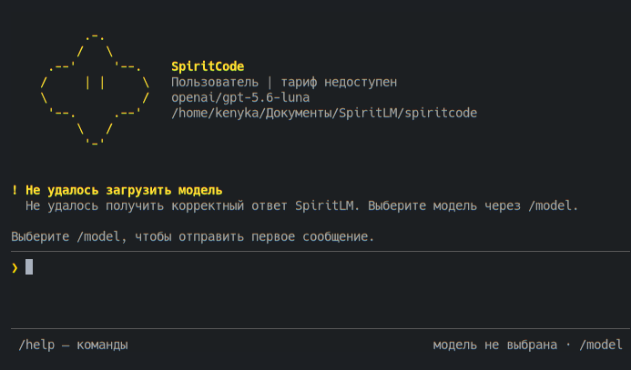

# SpiritCode

Терминальный кодинг-агент для SpiritLM. Python 3.12+, Linux, macOS и Windows.



## Установка

```sh
pip install spiritcode
sprt
```

При первом запуске введите API-ключ SpiritLM, затем выберите модель через `/model`.
`spiritcode` и `python -m spiritcode` — альтернативные способы запуска.

По умолчанию используется `https://spiritlm.netlify.app`. Для локальной разработки
запускайте `NODE_ENV=development sprt` (также поддерживается `dev`) — API будет
доступен по `http://localhost:3000`. Явный адрес в `--base-url`, `SPIRITLM_BASE_URL`
или `config.toml` имеет приоритет над автоматическим выбором.

## Команды

| Команда | Описание |
| --- | --- |
| `sprt` | Открыть чат в текущем проекте |
| `sprt login` | Войти по API-ключу |
| `sprt logout` | Удалить сохранённый ключ |
| `sprt models` | Показать модели |
| `sprt account` | Показать аккаунт |
| `sprt sessions` | Показать сохранённые сессии |
| `sprt resume <id>` | Продолжить сессию |
| `sprt --base-url <url> --model <id>` | Указать сервер без `/v1` и модель |
| `sprt --help` | Справка |
| `sprt --version` | Версия |

В чате:

| Команда | Описание |
| --- | --- |
| `/help` | Команды и сочетания клавиш |
| `/model [id]` | Поиск и смена модели |
| `/context` | Контекст, токены и диагностика сессии |
| `/profile` | Профиль SpiritLM |
| `/balance` | Баланс аккаунта |
| `/subscription` | Подписка и доступные кредиты |
| `/usage [2d\|7d\|30d\|all]` | Статистика аккаунта |
| `/new` | Новая сессия |
| `/sessions` | Сохранённые сессии |
| `/resume <id>` | Продолжить сессию |
| `/compact` | Сжать контекст отдельным оплачиваемым запросом |
| `/diff` | Правки сессии |
| `/undo` | Отменить последнюю группу правок |
| `/permissions` | Правила разрешений |
| `/exit` | Выход |
| `@путь` или `@"путь с пробелами"` | Прикрепить файл |
